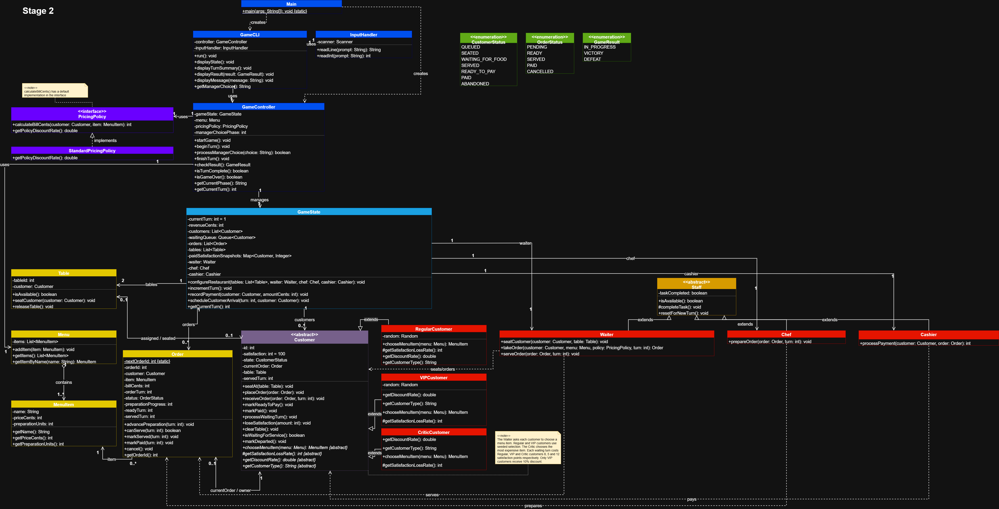

# SC2002 Restaurant Rush — Group Project

## Project Overview

Restaurant Rush is a turn-based restaurant management game developed in Java for the SC2002 Object-Oriented Design & Programming group assignment.

The player manages a restaurant over 18 turns by assigning tasks to the Waiter and Chef while balancing customer satisfaction, revenue and limited resources.

## URLs

- [Group repository](https://github.com/desmunz/SC2002-Restaurant-rush-group-project)
- [Stage 1 snapshot](https://github.com/desmunz/SC2002-Restaurant-rush-group-project/tree/stage-1)
- [Stage 2 snapshot](https://github.com/desmunz/SC2002-Restaurant-rush-group-project/tree/stage-2)

## How to Run

**Requirements:** Java JDK 17 or later.

Clone the repository:

```bash
git clone https://github.com/desmunz/SC2002-Restaurant-rush-group-project.git
cd SC2002-Restaurant-rush-group-project
```

Compile:

```bash
mkdir -p out
javac -d out $(find src/main/java -name "*.java")
```

Run:

```bash
java -cp out restaurantrush.Main
```

The game runs in the terminal. Follow the on-screen instructions to choose Waiter and Chef actions.

## Game Rules

- 18 turns, 2 tables and 6 customers.
- Customers arrive at turns 1, 4, 7, 10, 13 and 16.
- Waiter: one task per turn (seat, take order, serve or wait).
- Chef: one preparation unit per turn.
- Cashier: automatically processes at most one eligible payment per turn.

### Menu

| Item | Price | Preparation Units |
|---|---:|---:|
| Salad | $9.00 | 1 |
| Burger | $15.00 | 1 |
| Pasta | $18.00 | 2 |

### Customers

| Customer | Satisfaction lost per waiting turn | Discount | Selection rule |
| --- | --- | --- | --- |
| Regular | 8 | None | Seeded randomness, seed 12345; first choice is Burger |
| VIP | 5 | 10% | Seeded randomness, seed 67890; first choice is Burger |
| Critic | 12 | None | Most expensive item; first in menu order if prices tie. Currently Pasta |

### Victory Conditions

At the end of turn 18, the player wins if all three conditions are satisfied:

- At least 4 paid customers.
- At least $45.00 revenue.
- Average satisfaction of paid customers at least 60.

## Reproducible Test Runs

See [Test Notes](documents/tests/test-notes.md) for additional information.

### Victory

Run the following in a powershell console to reproduce the victory ending:

```powershell
Get-Content documents/tests/victory-input.txt | java -cp out restaurantrush.Main
```

### Failure

Run the following in a powershell console to reproduce the defeat ending:

```powershell
Get-Content documents/tests/defeat-input.txt | java -cp out restaurantrush.Main
```

## Stage 2 Diagrams



[Full-resolution diagram](documents/diagrams/stage-2-class-diagram.png)

## Development Stages

### Stage 1 — Basic Restaurant Simulation

Implements regular customers, the waiting queue, tables, menu, orders, staff actions, satisfaction, abandonment, payment and victory/defeat conditions.

### Stage 2 — Customer Behaviour Extension

Adds VIP and Critic customers alongside regular customers, introducing polymorphic satisfaction decay rates, VIP discounts and distinct Critic order or service behaviour within the existing turn flow.

## Changes from Stage 1

- Enabled VIPCustomer and CriticCustomer, keeping selection, waiting-loss and discount behaviour in customer subclasses.
- Added getCustomerType() to Customer and its subclasses for display labels.
- Updated Main to register the mixed arrival schedule, and GameCLI to show customer types and correctly format order details.
- Reused the existing staff, table, pricing and turn-flow implementations. The Stage 2 runs exercised the shared preparation, serving and payment flow with the new customer types.
