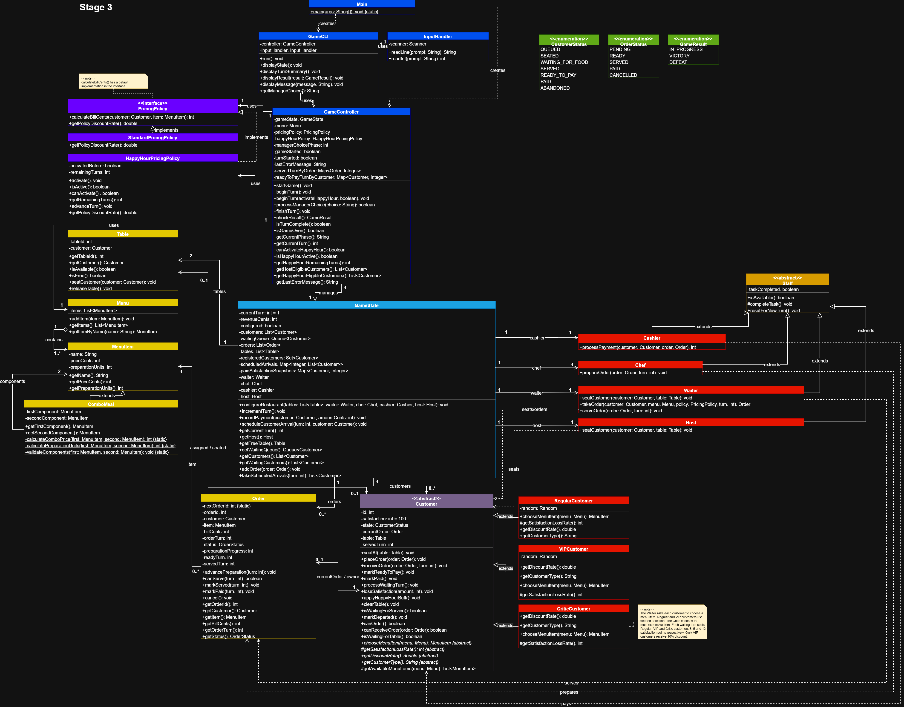
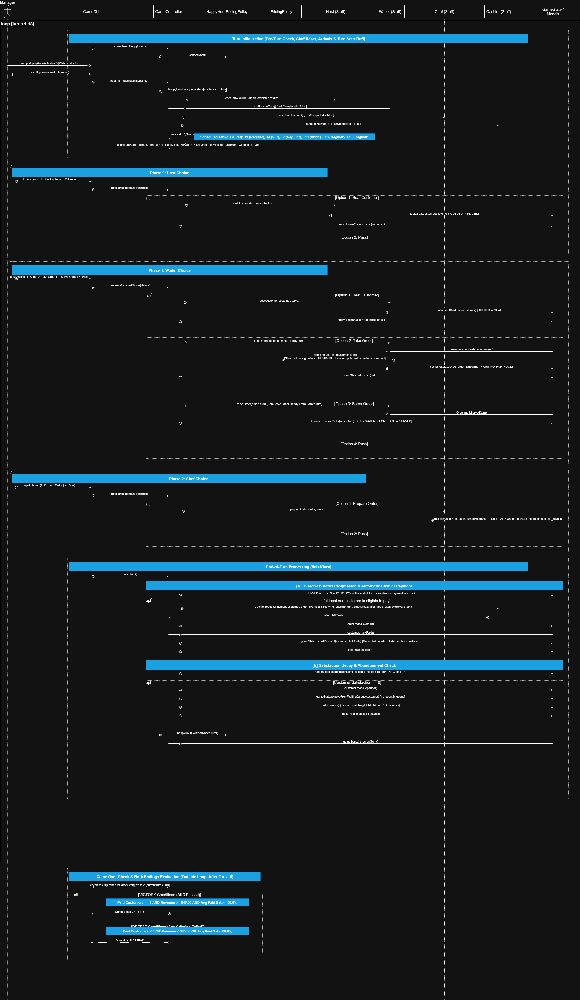

# SC2002 Restaurant Rush — Group Project

## Project Overview

Restaurant Rush is a turn-based restaurant management game developed in Java for the SC2002 Object-Oriented Design & Programming group assignment.

The player manages a restaurant over 18 turns by assigning tasks to the Waiter and Chef while balancing customer satisfaction, revenue and limited resources.

## URLs

- [Group repository](https://github.com/desmunz/SC2002-Restaurant-rush-group-project)
- [Stage 1 snapshot](https://github.com/desmunz/SC2002-Restaurant-rush-group-project/tree/stage-1)
- [Stage 2 snapshot](https://github.com/desmunz/SC2002-Restaurant-rush-group-project/tree/stage-2)
- [Stage 3 snapshot](https://github.com/desmunz/SC2002-Restaurant-rush-group-project/tree/stage-3)

## How to Run

**Requirements:** Java JDK 17 or later.

Clone the repository:

```bash
git clone https://github.com/desmunz/SC2002-Restaurant-rush-group-project.git
cd SC2002-Restaurant-rush-group-project
```

Compile:

```bash
mkdir -p out
javac -d out $(find src/main/java -name "*.java")
```

Run:

```bash
java -cp out restaurantrush.Main
```

The game runs in the terminal. Follow the on-screen instructions to choose Waiter and Chef actions.

## Game Rules

- 18 turns, 2 tables and 6 customers.
- Customers arrive at turns 1, 4, 7, 10, 13 and 16.
- Host: seats at most one queued customer per turn in addition to the Waiter's task.
- Waiter: one task per turn (seat, take order, serve or wait).
- Chef: one preparation unit per turn.
- Cashier: automatically processes at most one eligible payment per turn.

### Menu

| Item | Price | Preparation Units |
|---|---:|---:|
| Salad | $9.00 | 1 |
| Burger | $15.00 | 1 |
| Pasta | $18.00 | 2 |
| Salad + Pasta | $24.30 | 3 |

### Customers

| Customer | Satisfaction lost per waiting turn | Customer discount | Selection rule |
| --- | ---: | ---: | --- |
| Regular | 8 | None | Each Regular uses seed `12345`. Its first Stage 3 choice is Burger. |
| VIP | 5 | 10% | Each VIP uses seed `67890`. Its first Stage 3 choice is Salad + Pasta. |
| Critic | 12 | None | Chooses the most expensive item, taking the first in menu order if prices tie. In Stage 3 this is Salad + Pasta. |

### Happy Hour

Activation lasts for the current turn and the next. The CLI displays the remaining duration. At the start of each active turn, after arrivals, customers waiting for a table, an order or food recover 15 satisfaction, capped at 100. Orders placed during those turns receive 20% off after any VIP discount. Bills are stored in cents and locked when the Waiter takes the order. A VIP combo therefore costs `$24.30 × 0.90 × 0.80 = $17.50` after rounding, even if the Cashier collects payment several turns later.

### Victory Conditions

At the end of turn 18, the player wins if all three conditions are satisfied:

- At least 4 paid customers.
- At least $45.00 revenue.
- Average satisfaction of paid customers at least 60.

## Reproducible Test Runs

See [Test Notes](documents/tests/test-notes.md) for additional information.

### Victory

Run the following in a powershell console to reproduce the victory ending:

```powershell
Get-Content documents/tests/victory-input.txt | java -cp out restaurantrush.Main
```

### Failure

Run the following in a powershell console to reproduce the defeat ending:

```powershell
Get-Content documents/tests/defeat-input.txt | java -cp out restaurantrush.Main
```

## UML Class Diagrams

### Stage 1 Class Diagram


[View full-resolution Stage 1 diagram](documents/diagrams/stage-1-class-diagram.png)

### Stage 2 Class Diagram


[View full-resolution Stage 2 diagram](documents/diagrams/stage-2-class-diagram.png)

## Stage 3 Class Diagram



[View full-resolution Stage 2 diagram](documents/diagrams/stage-3-class-diagram.png)

## Stage 3 Sequence Diagram



[View full-resolution Stage 2 diagram](documents/diagrams/stage-3-sequence-diagram.png)

## Development Stages

### Stage 1 — Basic Restaurant Simulation

Implements regular customers, the waiting queue, tables, menu, orders, staff actions, satisfaction, abandonment, payment and victory/defeat conditions.

### Stage 2 — Customer Behaviour Extension

Adds VIP and Critic customers alongside regular customers, introducing polymorphic satisfaction decay rates, VIP discounts and distinct Critic order or service behaviour within the existing turn flow.

### Stage 3 — Staff, Menu and Happy Hour Extension

Adds a Host, combo meals and a once-per-game Happy Hour, introducing an independent seating allowance, bundled multi-unit dishes, start-of-turn satisfaction recovery and stacked order discounts.

### Changes from Stage 1 to Stage 2

Stage 2 introduces two new customer types using inheritance and polymorphism, while preserving the existing restaurant management workflow.

Code Changes
| File | Change | Description |
|---|---|---|
| `VIPCustomer.java` | Added | Implements VIP-specific satisfaction loss, discount and menu selection
| `CriticCustomer.java` | Added | Implements Critic-specific satisfaction loss and menu preference
| `Customer.java` | Modified | Introduces customer type identification through getCustomerType()
| `RegularCustomer.java` | Modified | Implements customer type identification
| `Main.java` | Modified | Updates customer arrivals to include Regular, VIP and Critic customers
| `GameCLI.java` | Modified | Displays customer types and improves order information

## Changes from Stage 2 to Stage 3

Stage 3 introduces a Host, combo meals and a once-per-game Happy Hour, while preserving the existing turn-based restaurant management workflow.

### Code Changes

| File | Change | Description |
|---|---|---|
| `Host.java` | Added | Implements customer seating with an independent per-turn task allowance |
| `ComboMeal.java` | Added | Combines two existing menu items with a 10% bundle discount and summed preparation units |
| `HappyHourPricingPolicy.java` | Added | Manages one-time Happy Hour activation, two-turn duration and a 20% stacked discount |
| `Customer.java` | Modified | Adds capped `+15` Happy Hour satisfaction recovery for waiting customers via `applyHappyHourBuff()` |
| `GameState.java` | Modified | Registers and provides access to the `Host` alongside existing restaurant staff |
| `GameController.java` | Modified | Coordinates Happy Hour activation, turn-start satisfaction recovery, the `HOST` phase and active pricing selection |
| `GameCLI.java` | Modified | Adds Happy Hour activation and Host seating prompts, and displays active status and eligible customers |
| `Main.java` | Modified | Instantiates the `Host` and registers the `Salad + Pasta` combo meal on the menu |

### Design Considerations

The existing `Customer` class provides a common abstraction for all customer types. Each subclass overrides methods to define its own satisfaction loss, discount and menu-selection behaviour.

This demonstrates inheritance and polymorphism, allowing the game to support new customer types without creating separate service workflows.

The existing `GameController`, `Waiter`, `Chef`, `Cashier` and pricing components continue to handle customer interactions through shared interfaces.

### GitHub Comparison

[View changes from Stage 1 to Stage 2](https://github.com/desmunz/SC2002-Restaurant-rush-group-project/compare/stage-1...stage-2)

## Project Structure

```text
src/main/java/restaurantrush/
├── Main.java
├── boundary/
│   ├── GameCLI.java
│   └── InputHandler.java
├── control/
│   ├── GameController.java
│   ├── GameState.java
│   └── GameResult.java
└── model/
    ├── Order.java
    ├── Table.java
    ├── customer/
    │   ├── Customer.java
    │   ├── RegularCustomer.java
    │   ├── VIPCustomer.java
    │   └── CriticCustomer.java
    ├── enums/
    ├── menu/
    ├── pricing/
    └── staff/
```

The project separates responsibilities into three main components:

- **Boundary:** Handles user input and displays game information through the command-line interface.
- **Control:** Manages game progression, turn-based actions and victory/defeat conditions.
- **Model:** Represents customers, staff, orders, tables, menu items and pricing policies.

This structure supports modularity, code reuse and incremental development across the three project stages.

## Testing and Verification

The project includes reproducible test inputs for both victory and defeat scenarios.

Detailed test observations are documented in [Test Notes](documents/tests/test-notes.md).

### Documented Test Results Summary

| Scenario | Result | Served Customers | Revenue | Average Paid Satisfaction |
|---|---|---:|---:|---:|
| Victory | VICTORY | 5 | $76.50 | 79.6 |
| Defeat | DEFEAT | 0 | $0.00 | N/A |

Both documented scenarios complete all 18 turns.

The tests demonstrate the game outcome conditions and exercise the restaurant's customer service workflow. Additional Stage 2 testing covers VIP discounts, different waiting penalties and Critic menu selection.

## Individual AI histories and recorded presentation

Each member’s full project-related AI history belongs on their personal branch. **Pending for submission:** add each member’s name and history link, followed by the recording location and the actual start time of each segment below.

| Presentation segment | Start time |
| --- | --- |
| Launching the game from the submitted project | Pending |
| Manager decision with competing staff tasks | Pending |
| One dish progressing from `READY` to `SERVED` to payment | Pending |
| VIP or Critic behaviour | Pending |
| Stage 3 feature demonstration | Pending |
| Reproducible victory and defeat | Pending |
| Stage comparisons and diagrams | Pending |